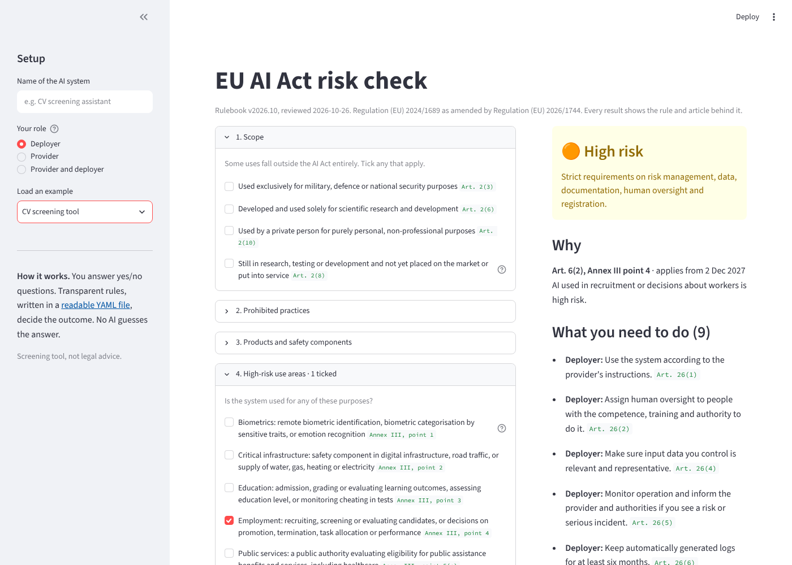
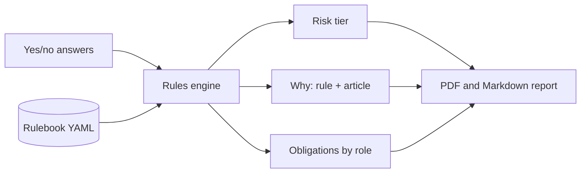

# EU AI Act Risk Check

[](https://github.com/gifmaster/ai-act-risk-check/actions/workflows/tests.yml)
[](https://ai-act-risk-check.streamlit.app)

**Find out where an AI system sits under the EU AI Act, and see exactly why.**

Answer a set of yes/no questions about an AI system. The tool tells you its risk tier (prohibited, high risk, transparency, minimal or out of scope), the article behind every conclusion, and a checklist of what you need to do as a provider or deployer.

Up to date with the **Digital Omnibus on AI** (Regulation (EU) 2026/1744), including the new high-risk dates and the two new prohibitions.



**[Try it live](https://ai-act-risk-check.streamlit.app)**

---

## Why rules, not an LLM

A compliance tool that cannot explain its own answer undermines the very thing it is checking for.

So the classification is done by **transparent rules**, not by a language model guessing. The rules live in one readable file ([`eu_ai_act.yaml`](src/riskcheck/rulebooks/eu_ai_act.yaml)), and each one looks like this:

```yaml
- id: high.employment
  when: {all: [a3_employment, $no_exception]}
  tier: high
  cite: Art. 6(2), Annex III point 4
  applies_from: "2027-12-02"
  reason: AI used in recruitment or decisions about workers is high risk.
```

That means:

- **Same answers, same result.** Every time.
- **Every result is traceable** to a rule and an article.
- **A lawyer can review the logic** without reading Python.
- **The rules are tested.** Real cases (CV screening, credit scoring, chatbots, deepfakes) are pinned down in [`tests/test_scenarios.py`](tests/test_scenarios.py), so a change that breaks the law's logic fails the build.

## What it covers

| Area | Articles |
|---|---|
| Scope exclusions (military, research, personal use, pre-market) | Art. 2 |
| Prohibited practices, incl. the two added in 2026 | Art. 5 |
| High risk through regulated products | Art. 6(1), Annex I |
| High risk through use area (HR, credit, education, insurance ...) | Art. 6(2), Annex III |
| The "not high risk after all" exception, and why profiling cancels it | Art. 6(3)-(4) |
| Provider and deployer obligations, incl. fundamental rights impact assessment | Arts. 9-17, 26, 27, 43-49, 72-73, 86 |
| Transparency for chatbots, generated content and deepfakes | Art. 50 |
| Systems that act on their own with tool or data access: an optional question that adds a note on oversight and logging, never changes the tier | Arts. 12, 14, 26 |
| General-purpose AI model providers | Arts. 53, 55 |
| AI literacy | Art. 4 |

Results can be downloaded as a PDF report to share, or as a Markdown report with a checklist, ready to drop into an AI register or a ticket. The [AI Use Case Register](https://github.com/gifmaster/ai-use-case-register) imports the Markdown report.

## How it works



The engine (`src/riskcheck/engine.py`) knows nothing about the AI Act. It reads a rulebook, checks it for mistakes (unknown questions, missing citations, duplicate rules), and evaluates it. **Swap the rulebook and the same engine screens a different regulation.** A DORA rulebook is next.

## Run it locally

```bash
git clone https://github.com/gifmaster/ai-act-risk-check.git
cd ai-act-risk-check
pip install -r requirements.txt
streamlit run app.py
```

Or use the engine from Python:

```python
from riskcheck import Rulebook, evaluate

rb = Rulebook.builtin("eu_ai_act")
result = evaluate(rb, {"a3_credit": True}, role="deployer")

print(result.tier.label)                 # High risk
for rule in result.reasons:
    print(rule.cite, "-", rule.reason)
```

## Tests

```bash
pip install pytest
pytest
```

The suite covers the engine, rulebook validation, real-world scenarios, and a smoke test of the app itself.

**Acceptance tests.** 20 cases (CV screening, credit scoring, a nudify app, a military system and more) live in [`tests/acceptance_cases.yaml`](tests/acceptance_cases.yaml). The same file runs automatically in CI and generates a [manual test plan](docs/TEST-PLAN.md) for clicking through the live app, so the human checks and the automated checks are always the same.

## Project structure

```
app.py                              Streamlit interface
src/riskcheck/engine.py             Generic rules engine + validation
src/riskcheck/report.py             Markdown report
src/riskcheck/pdf.py                PDF version of the report
src/riskcheck/rulebooks/eu_ai_act.yaml   The EU AI Act, as rules
tests/                              Engine, scenario and app tests
docs/METHOD.md                      How the rules were built and their limits
```

## Limitations

This is a **screening tool, not legal advice**. It simplifies some provisions (for example the narrow law-enforcement exceptions in Art. 5(1)(h) and the open-source exemptions) and relies on honest answers. It now also warns when a scope exclusion conflicts with another use (Recital 24), moves a deployer into the provider role when they rebrand or modify a high-risk system (Art. 25), and flags that the Art. 6(3) exception is a self-assessment that authorities can review (Art. 80). A prohibited result lists only the ban. See [docs/METHOD.md](docs/METHOD.md) for the full list. Confirm any high-risk or prohibited result with a qualified lawyer.

## Roadmap

- [ ] Optional LLM helper that reads a plain-text description and pre-fills the answers (the rules still decide)
- [ ] Danish language version
- [ ] DORA readiness rulebook on the same engine
- [ ] Export results straight into an AI use case register

## About

Built by **Alexander Senderovitz**, AI governance and digital transformation, Copenhagen.
I help organisations put the EU AI Act into practice. [senderovitz.eu](https://senderovitz.eu) · [alexander@senderovitz.eu](mailto:alexander@senderovitz.eu)

**Next step after classifying:** the [Practical AI Governance Framework](https://github.com/gifmaster/ai-governance-framework) covers the rest: policy, roles, the use case lifecycle and templates. Buying an AI tool? Check the vendor contract with the [AI Contract Clause Checker](https://github.com/gifmaster/contract-clause-checker). Then log the result in the [AI Use Case Register](https://github.com/gifmaster/ai-use-case-register), which imports this tool's report. To see which of the AI Act, GDPR, NIS2 and DORA apply to you, and where they overlap, use the [Regulation Navigator](https://github.com/gifmaster/regulation-navigator).

Licensed under the [GNU AGPL-3.0](LICENSE): free to use, study and change. If you run a modified version as a service, you must share its source code. Commercial license without these terms: [alexander@senderovitz.eu](mailto:alexander@senderovitz.eu).

## Experimental: run it in the browser (no server)

`python scripts/build_stlite.py` builds a static copy that runs the unchanged app inside the visitor's browser with [stlite](https://github.com/whitphx/stlite). It can be hosted for free on GitHub Pages, never goes to sleep, and uploaded files never leave the visitor's computer. The first load is slower (Python starts in the browser). This is a test next to the normal Streamlit app, not a replacement.
